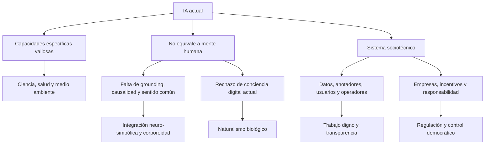

# Afirmaciones sobre entrenamiento y visión de la IA de Ramón López de Mántaras

## Conclusión

La advertencia central de López de Mántaras es sólida: los sistemas actuales no son autónomos respecto de las personas y las instituciones que seleccionan datos, definen objetivos, evalúan respuestas, corrigen comportamientos y asumen —o eluden— responsabilidades. También acierta al exigir prudencia ante respuestas persuasivas, antropomorfización, delegación cognitiva y usos de alto riesgo.

Su discurso pierde precisión cuando convierte esa crítica en afirmaciones universales. La presencia de trabajo humano no demuestra por sí misma que el modelo carezca de capacidades aprendidas; el carácter probabilístico no explica por sí solo todos los errores; los datos sintéticos no degradan necesariamente un modelo; aumentar escala no implica empeorar; y que la conciencia solo pueda existir en seres vivos es una posición filosófica, no un resultado experimental establecido.

La mejor lectura es usarlo como **correctivo frente al marketing**, no como teoría técnica completa de los LLM.

### Alcance del término «ChatGPT»

Mántaras emplea con frecuencia «ChatGPT» como nombre genérico del asistente conversacional basado en LLM, del mismo modo que una marca dominante puede nombrar coloquialmente una categoría. Por ello, el análisis interpreta sus afirmaciones en tres niveles:

1. **Industria de IA:** trabajo de datos, concentración empresarial, incentivos comerciales y responsabilidad.
2. **LLM generativos:** entrenamiento probabilístico, alucinaciones, representaciones, grounding y antropomorfización.
3. **OpenAI/GPT:** solo cuando identifica la empresa, una versión del modelo o una política concreta.

Las referencias técnicas de OpenAI se utilizan porque son documentación primaria accesible de un actor relevante, no porque el argumento de Mántaras se limite a esa empresa ni porque sus prácticas representen automáticamente a toda la industria.

## 1. Qué significa realmente «entrenar» un LLM

| Etapa | Qué ocurre | Intervención humana | Matiz frente al vídeo |
| --- | --- | --- | --- |
| Preentrenamiento | Se optimizan parámetros para predecir tokens sobre grandes corpus. | Producción original de textos, licencias, selección, limpieza, filtrado y diseño de la receta. | No exige que una persona etiquete cada fragmento. Gran parte del proceso es autosupervisado. |
| Ajuste supervisado | Se entrena con instrucciones y respuestas consideradas deseables. | Personas o modelos redactan ejemplos; especialistas revisan dominios sensibles. | Aquí la afirmación sobre trabajo humano es directa y correcta. |
| Preferencias y refuerzo | Se comparan respuestas y se optimiza hacia señales de recompensa. | Anotadores, expertos, evaluadores automáticos y políticas de producto. | «Preferido» no equivale siempre a «verdadero»; puede introducir sesgos o adulación. |
| Evaluación y seguridad | Se prueban capacidades, fallos, abuso, factualidad y estilo. | Red teams, expertos, usuarios de prueba y evaluaciones automáticas. | Evaluar no siempre modifica el modelo, pero condiciona su lanzamiento y ajustes. |
| Uso y feedback | El sistema genera con pesos ya fijados; algunas conversaciones o votos pueden guardarse. | El usuario aporta contexto y, si corresponde, datos o feedback para versiones futuras. | No aprende normalmente en tiempo real de cada conversación. |
| Operación asistida | Un humano resuelve excepciones o supervisa un sistema desplegado. | Operadores, moderadores o revisores. | Es operación «human in the loop», no necesariamente entrenamiento. |

El trabajo clásico de InstructGPT documentó un equipo de 40 contratistas para demostraciones y preferencias, y explica que el resultado refleja las preferencias de ese grupo, no unos «valores humanos» universales. La documentación actual de OpenAI confirma que las conversaciones de servicios de consumo pueden utilizarse en entrenamiento posterior si el usuario no se excluye, y que un voto puede hacer utilizable la conversación asociada. Los productos empresariales y la API no se usan para entrenamiento por defecto. Esto respalda el mecanismo descrito por Mántaras, pero no una cifra global de trabajadores ni aprendizaje instantáneo.

Fuentes: [InstructGPT](https://cdn.openai.com/papers/Training_language_models_to_follow_instructions_with_human_feedback.pdf), [uso de datos y controles de entrenamiento](https://help.openai.com/en/articles/5722486-chatgpt-privacy-policies), [explicación de actualizaciones y señales de feedback](https://openai.com/index/expanding-on-sycophancy/).

## 2. Revisión de afirmaciones del vídeo

| Afirmación | Evaluación | Confianza | Comentario |
| --- | --- | --- | --- |
| La IA depende de trabajo humano invisible. | Sustancialmente correcta. | Alta | Datos, anotación, preferencias, moderación, evaluación y operación sostienen el sistema. «No tan artificial» es una metáfora sociotécnica útil. |
| Parte de ese trabajo es precario y mal pagado. | Bien apoyada cualitativamente. | Alta | OIT y Fairwork documentan bajos ingresos, inseguridad contractual y falta de protección en plataformas de microtrabajo y cadenas de anotación. |
| Son millones de personas y algunas cobran unos 0,60 euros por hora. | Plausible en casos concretos, no demostrado como cifra general del entrenamiento de IA. | Baja | Las estimaciones amplias de trabajo en plataformas incluyen muchas ocupaciones ajenas a la anotación. El vídeo no identifica estudio, país, periodo ni denominador. |
| Los votos de usuarios sirven para mejorar versiones futuras. | Correcta con condiciones. | Alta | Depende del producto y de los controles de datos; el uso es posterior y agregado, no aprendizaje inmediato. |
| Un LLM no comprende y solo calcula probabilidades. | La descripción del objetivo de entrenamiento es correcta; la conclusión sobre comprensión es debatida. | Media | Predecir tokens es el objetivo, pero los modelos desarrollan representaciones internas y capacidades no codificadas explícitamente. No existe una prueba consensuada de «comprensión». |
| Hace falta un cuerpo para una inteligencia general. | Hipótesis científica relevante, no necesidad demostrada. | Media-baja | La cognición corporizada y el aprendizaje causal son líneas activas; el rendimiento de modelos de texto muestra que puede adquirirse bastante estructura sin cuerpo físico. |
| La conciencia solo puede darse en seres vivos. | Posición filosófica no falsada, pero no consenso científico. | Baja como hecho; alta como descripción de su postura | Coincide con el naturalismo biológico. Compite con funcionalismo, emergentismo y otras teorías de la conciencia. |
| La IA específica tiene gran valor en ciencia y salud. | Correcta. | Alta | Su propio ejemplo de AlphaFold muestra que utilidad e inteligencia humana no son la misma pregunta. |
| Delegar sistemáticamente escritura o navegación puede deteriorar habilidades. | Hay evidencia inicial y analogías razonables; no es un destino inevitable. | Media | El efecto depende de edad, tarea, diseño, supervisión y modo de uso. La IA con andamiaje puede apoyar el aprendizaje. |
| El principal problema es la responsabilidad humana y empresarial. | Juicio normativo bien fundamentado. | Alta como recomendación | Evita tratar el sistema como agente moral y conserva trazabilidad sobre diseñadores, desplegadores y usuarios. |

Fuentes laborales: [OIT, trabajo en plataformas digitales](https://www.ilo.org/publications/digital-labour-platforms-and-future-work-towards-decent-work-online-world), [Fairwork AI Ratings 2024/5](https://fair.work/en/fw/publications/fairwork-ai-ratings-2024-5-who-powers-ai-assessing-fairness-in-the-ai-supply-chain-humans-in-the-loop-as-a-case-study/), [Fairwork Cloudwork Ratings 2023](https://fair.work/en/fw/publications/fairwork-cloudwork-ratings-2023-work-in-the-planetary-labour-market/).

## 3. Datos sintéticos, tamaño y alucinaciones: ampliación posterior de su postura

Estas afirmaciones **no pertenecen al vídeo capturado**. Aparecen en una entrevista de BioBioChile del 22 de enero de 2026 y ayudan a entender cómo evolucionó su argumento:

- que los modelos se entrenan cada vez más con salidas de otros modelos;
- que más del 50 % de los datos serían erróneos;
- que los modelos mayores obtendrían resultados más pobres;
- que las versiones posteriores, de GPT-4 a GPT-5 y futuras, alucinarían más;
- que el proceso podría terminar en colapso.

### Qué está respaldado

El riesgo de **colapso de modelo** existe si datos generados por modelos sustituyen recursivamente los datos reales sin control. El trabajo de Shumailov y colaboradores muestra pérdida de las colas de la distribución y degradación al entrenar generaciones sobre contenido sintético usado indiscriminadamente. Por tanto, la alerta sobre procedencia y diversidad de los datos es legítima.

Fuente: [Shumailov et al., *Nature* 2024](https://www.nature.com/articles/s41586-024-07566-y).

### Qué necesita matiz o no está demostrado

- **No todo dato sintético es basura.** Si se conserva el dato real y se acumula junto con sintético, el colapso no aparece necesariamente. Datos sintéticos diseñados, filtrados y verificados han mejorado modelos como Phi-4 y tareas de embeddings.
- **No hay base pública para «más del 50 %».** «Erróneo» no se define y las mezclas de entrenamiento de modelos propietarios no son totalmente públicas. Debe tratarse como cifra no verificada.
- **Más grande no significa peor de forma general.** Las leyes de escala muestran mejoras predecibles al aumentar modelo, datos y cómputo de forma equilibrada. Chinchilla mostró además que un modelo menor y mejor entrenado puede superar a otro mayor: el tamaño aislado no basta.
- **La predicción de más alucinaciones no se ha cumplido como regla universal.** La evaluación del proveedor informa de que GPT-5-main tuvo un 26 % menos de afirmaciones alucinadas que GPT-4o en tráfico de ChatGPT con navegación. Es evidencia de parte interesada y dependiente del benchmark, pero contradice la afirmación categórica de degradación inevitable.

Fuentes: [acumulación de datos reales y sintéticos](https://arxiv.org/abs/2404.01413), [Phi-4 Technical Report](https://arxiv.org/abs/2412.08905), [leyes de escala](https://arxiv.org/abs/2001.08361), [Chinchilla](https://arxiv.org/abs/2203.15556), [evaluación de alucinaciones de GPT-5](https://deploymentsafety.openai.com/gpt-5/long-form-biological-risk-questions), [entrevista posterior en BioBioChile](https://www.biobiochile.cl/noticias/ciencia-y-tecnologia/ciencia/2026/01/22/ramon-lopez-de-mantaras-experto-en-ia-nos-encontraremos-personas-casi-analfabetas-de-tanto-usarla.shtml).

## 4. ¿Los LLM solo imitan o forman representaciones del mundo?

López de Mántaras se alinea con la tesis de que aprender solo la forma del lenguaje no garantiza significado. Bender y Koller argumentaron que la relación entre expresión, intención comunicativa y mundo no puede reducirse a patrones formales del texto. Los fallos causales, la fragilidad fuera de distribución y las alucinaciones apoyan su cautela.

Sin embargo, «solo regurgitan» es demasiado reductivo. En entornos controlados, transformadores entrenados para predecir secuencias aprenden representaciones del tablero de Othello; en LLM reales se han encontrado representaciones lineales de espacio y tiempo. Estas evidencias no prueban conciencia ni comprensión humana, pero muestran que la predicción puede inducir estructura interna más rica que una base de frases copiadas.

La formulación más prudente es: **los LLM aprenden representaciones útiles y pueden realizar inferencias, pero no está demostrado que posean comprensión semántica, causal y situada comparable a la humana**.

Fuentes: [Bender y Koller, ACL 2020](https://aclanthology.org/2020.acl-main.463/), [representaciones de espacio y tiempo, ICLR 2024](https://arxiv.org/abs/2310.02207), [revisión de la hipótesis de mundo en Othello, 2025](https://arxiv.org/abs/2503.04421).

## 5. Delegación cognitiva y educación

La analogía con el GPS tiene apoyo empírico: un estudio con 50 conductores y un seguimiento longitudinal pequeño encontró asociación entre uso habitual de GPS y peor memoria espacial sin ayuda, aunque el seguimiento de 13 personas obliga a prudencia.

Sobre IA generativa, la evidencia todavía es temprana:

- Una encuesta de 319 trabajadores encontró que mayor confianza en la IA se asociaba con menor esfuerzo de pensamiento crítico autoinformado; también observó que la actividad crítica se desplaza hacia verificar, integrar y supervisar.
- Un experimento de campo con casi mil estudiantes de matemáticas encontró que un tutor generativo sin salvaguardas mejoraba la práctica asistida pero podía perjudicar el rendimiento posterior sin IA; un diseño con andamiaje mitigaba el daño.
- El estudio EEG sobre escritura asistida por ChatGPT sugiere menor implicación cognitiva y peor recuerdo, pero es un preprint de alcance limitado y no justifica hablar de «analfabetismo» como resultado inevitable.

La recomendación operativa no es prohibir la herramienta, sino conservar actividad cognitiva del usuario: borrador propio, explicación de decisiones, contraste de fuentes, revisión crítica y evaluación sin ayuda cuando la competencia personal sea el objetivo.

Fuentes: [GPS y memoria espacial](https://www.nature.com/articles/s41598-020-62877-0), [GenAI y pensamiento crítico, CHI 2025](https://www.microsoft.com/en-us/research/publication/the-impact-of-generative-ai-on-critical-thinking-self-reported-reductions-in-cognitive-effort-and-confidence-effects-from-a-survey-of-knowledge-workers/), [IA generativa sin salvaguardas y aprendizaje matemático](https://papers.ssrn.com/sol3/papers.cfm?abstract_id=4895486), [*Your Brain on ChatGPT*](https://www.media.mit.edu/publications/your-brain-on-chatgpt/).

## 6. Mapa de su visión de la IA

## 7. Contraste con la fuente de Geoffrey Hinton de la bóveda

| Eje | López de Mántaras | Geoffrey Hinton |
| --- | --- | --- |
| Conciencia de máquina | La considera ligada a seres vivos y al cuerpo. | Admite experiencia subjetiva artificial desde un enfoque funcional. |
| Riesgo dominante | Daños actuales: engaño antropomórfico, explotación, dependencia, poder corporativo y pérdida de responsabilidad. | Añade un riesgo fuerte de pérdida de control frente a sistemas superiores. |
| Valor de los LLM | Herramientas impresionantes, pero científicamente desviadas de la inteligencia general. | Resultado potente del aprendizaje conexionista y posible precursor de sistemas más capaces. |
| Camino técnico | Corporeidad, causalidad, transferencia e integración neuro-simbólica. | Redes neuronales, aprendizaje y mecanismos de seguridad/alineamiento. |
| Coincidencias | Concentración empresarial, necesidad de regulación, educación crítica, riesgos de desinformación y obligación humana de gobernar la tecnología. | Concentración empresarial, necesidad de regulación, educación crítica, riesgos de desinformación y obligación humana de gobernar la tecnología. |

El contraste demuestra que la experiencia científica no produce consenso automático. Las diferencias dependen de teorías de mente, criterios de inteligencia y prioridades de riesgo.

## 8. Criterio de uso para la bóveda

- Citar el vídeo para describir la **posición de López de Mántaras**, no como demostración concluyente de ausencia de comprensión o conciencia.
- Separar siempre preentrenamiento, postentrenamiento, feedback, moderación y operación humana.
- Mantener las cifras laborales como `needs-verification` hasta localizar su fuente original.
- Presentar el colapso por datos sintéticos como riesgo condicional, no destino inevitable.
- En sanidad, usar su advertencia como criterio prudencial: un LLM puede apoyar búsqueda, redacción o síntesis, pero no sustituir validación clínica, consentimiento, privacidad, trazabilidad ni responsabilidad profesional.
- Revisar esta nota si aparecen auditorías independientes de datos de entrenamiento, nuevas evaluaciones de alucinación o evidencia longitudinal sobre aprendizaje y delegación cognitiva.
